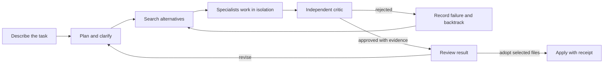

<div align="center">

# Canopy

### Governed autonomy for real software work

> **Curated source preview.** This repository contains a reviewed source snapshot,
> without the original private Git history, operational records or media captures.
> It is not a release or a full acceptance certification. GitHub Actions is disabled
> for this initial publication. See [public readiness](docs/public-readiness.md)
> for the exact validation scope and remaining portability work.

**Explore alternatives. Coordinate specialists. Review evidence. Adopt deliberately.**

[](https://github.com/revoydotdev/canopy-public/actions/workflows/ci.yml)
[](https://bun.sh)
[](https://www.typescriptlang.org/)
[](LICENSE)

[Quick start](#quick-start) | [Product surfaces](#product-surfaces) | [Architecture](docs/architecture.md) | [Operator guide](docs/operator-guide.md) | [1.0.0 roadmap](docs/roadmap-1.0.0-and-documentation-governance.md) | [Interface showcase](docs/interface-showcase.md)

</div>

<div align="center">
  <p>The previous campaign replay is omitted from this candidate pending rebranding and provenance review. It was generated from filtered campaign events, not captured product footage.</p>
</div>

Canopy is a governed software-work harness that treats autonomous work as a search tree instead of a linear prompt chain. It plans, edits, inspects, verifies, reviews, communicates, recovers, and coordinates across repositories. Governance limits authority, not subject matter: project packaging, language, framework, and linguistic style are inputs to the work, not restrictions on what the harness can attempt.

The system explores competing actions with UCT, delegates bounded work to specialists, learns from failed branches, backtracks, and promotes results only after review and evidence gates. CLI, MCP, WebUI, TUI, remote control, and integration surfaces project one runtime.

The root workspace keeps the legacy `revoy2` package name, while users run the CLI as `arbor`. These are implementation and command identifiers; Canopy is the product name.

## What makes it different

| Typical coding loop | Canopy |
|---|---|
| One plan moves forward | Alternatives form a scored, inspectable action tree |
| A failed attempt is discarded | Failure becomes provenance-typed knowledge and informs backtracking |
| Agent output is trusted as prose | Claims, critic approval, generated facts, and verified evidence are distinct types |
| One agent proposes and judges | Specialist and critic authority are structurally separated |
| Context is the state | Hash-chained ledgers and sealed stores are authority; interfaces are projections |
| Cancellation loses the thread | Interruptions, leases, sessions, and retries have explicit recovery semantics |
| Parallel workers rely on convention | Scopes, peer grants, writer locks, fencing, collision detection, and adoption receipts are enforced |

## The product loop



In practice:

1. Start with `arbor task`, the Cockpit, or the WebUI composer.
2. Review the proposed scope, questions, governance tier, and capabilities.
3. Let Crown branch and coordinate Seed or Heartwood specialists in isolated worktrees.
4. Inspect the live tree, sessions, peer messages, cost, evidence, and attention states.
5. Review changed files, critic verdict, verification commands, and conflicts.
6. Adopt all or selected files through a fenced result boundary; use the receipt to undo if needed.

Tasks can include up to four PNG, JPEG, GIF, or WebP references from the CLI,
Cockpit, or WebUI. Canopy stores each image by content hash, verifies it again
after restart, requires an explicitly image-capable native provider, and makes
the same governed media available to planning and Specialist execution. It
never silently sends images through a connector that cannot prove consumption.

## Product surfaces

| Area | Surface |
|---|---|
| Generalist execution | Deterministic offline lane, native Canopy sessions (the only default harness), deprecated Claude Code and OpenCode connector lanes behind an explicit config opt-in (ADR-192), repository tools, governed subagents |
| Tree cognition | UCT selection, branching, pruning, backtracking, convergence, failure-memory injection, bounded budgets |
| Coordination | Parent-child threads, sibling query/reply grants, live session attach and steering, cross-repository distributed control, A2A profile adapters |
| Safety | Capability admission, isolated worktrees, scoped credentials, OS sandbox contracts, writer locks, fencing, collision denial, cancellation, stale-lease recovery |
| Review | Unified and side-by-side diffs, file tree, inline comments, revision requests, editor handoff, selective adoption, conflict preview, receipt-bound revert |
| Interfaces | Task-first CLI, MCP server, responsive WebUI, Bun-native OpenTUI Cockpit, authenticated remote listener |
| Continuity | Durable session identity, bounded replay checkpoints, history, continuation lineage, follow-up lineage, notification inbox |
| Extensibility | Signed integration marketplace, local registry, installable SDK, commands, skills, hooks, MCP adapters, permission and health inspection |
| Operations | Unified doctor, setup and migration previews, schedules, remote trust, maintenance, DevTools, telemetry, cost and token economy |
| Evidence | Deterministic evaluation, evidence-backed campaign history, flight-control exercises, and publication tooling for reviewed MP4/WebM derivatives |

## Quick start

### Requirements

- Bun 1.4.0 for package management, CLI execution, and native OpenTUI
- Node.js 22 for the Vitest worker lane and selected tooling
- Git for isolated worktrees and result adoption

```bash
git clone https://github.com/revoydotdev/canopy-public.git canopy
cd canopy
bun install --frozen-lockfile
bun run build
bun run dev:install

arbor project enroll . --dry-run
arbor project enroll .
arbor doctor
```

For an existing repository, enrollment recognizes `package.json`, `pyproject.toml`, `Cargo.toml`, and `go.mod`. It derives only commands that the repository declares or that the selected project profile supplies. If it cannot establish a safe build or verification command, it stops with the missing prerequisite instead of guessing.

Run a real offline campaign without a provider key or network request:

```bash
arbor run --once --executor deterministic --persistence-dir .arbor/quickstart
```

The deterministic executor deliberately returns claimed, not verified, output because it does not run an external verification command. See the [five-minute quickstart](docs/five-minute-quickstart.md) for what the run creates and how to inspect it.

Launch either interactive surface:

```bash
arbor tui
arbor webui
```

### Provider-backed work

Create missing templates without overwriting existing configuration:

```bash
arbor setup
```

Configure an OpenAI-compatible provider in `arbor.jsonc` and place only its secret in the ignored `.env`:

```jsonc
{
  "native": {
    "mode": "native",
    "provider_id": "openai-compatible",
    "base_url": "https://provider.example/v1",
    "model": "provider-model-id",
    "transport": {
      "max_response_bytes": 4194304
    }
  }
}
```

Native SSE responses remain hard-bounded at 8 MiB. The 4 MiB default accommodates reasoning-bearing provider envelopes; set `native.transport.max_response_bytes` lower or higher when a provider's documented behavior requires it. `native.transport.timeout_ms` similarly configures a per-attempt ceiling up to five minutes. When `native.usage_budget` is configured, `estimate_max_output_tokens` is the per-request completion limit sent to the provider as `max_tokens`; it defaults to 8,000 so that the token budget, not the response byte limit, ends a long reasoning turn (a reasoning stream spends roughly 400 raw SSE bytes per token, so 16,000 tokens can overrun 4 MiB).

Then use the task lifecycle:

```bash
arbor doctor
arbor task "Trace the defect, implement the narrowest fix, and verify it"
arbor task "Match this interface while preserving accessibility" --attach ./reference.png
arbor task confirm <draft-id> <revision> --wait
arbor resume --preview
arbor resume
arbor report --campaign <campaign-id>
arbor adopt --campaign <campaign-id>
arbor adopt --campaign <campaign-id> --apply
```

After a process or machine interruption, `arbor resume` discovers the current repository's durable interrupted session, reconciles a hard-crash checkpoint, recomposes fresh authority, and waits for the continued campaign. It is intentionally simple when exactly one session is recoverable and refuses to guess when branches collide; use `arbor resume <session-id>` to select explicitly. `--preview` performs discovery without mutation and lists any indeterminate operations that require an explicit `--disposition <operation>=<decision>` before work can continue.

The Canopy native lane is the only default campaign harness (ADR-192); there is no silent fallback. Configure a native credential as described in `docs/native-provider-auth.md` and confirm it with `arbor doctor`. With no ready native credential a campaign fails closed and points at `arbor doctor`.

The opencode, claude-code and codex connector lanes are deprecated until after 1.0.0. They are refused unless `arbor.jsonc` sets `connectors.allow_deprecated: true` with a single-line `connectors.reason`; there is no environment-variable opt-in, and the reason is recorded in the ledger of every run that uses a deprecated lane. With the opt-in set, an existing Claude Code OAuth login (`claude login`) is selected with `ARBOR_HARNESS_INTEGRATION=claude-code`; Canopy invokes documented print mode with bounded roles and tools and does not read or copy Claude Code credentials.

A deprecated Codex CLI lane is selected the same way, after the opt-in:

```bash
export ARBOR_HARNESS_INTEGRATION=codex
# Optional when `codex` is not already on PATH:
export ARBOR_CODEX_BIN=/path/to/codex
# Optional: otherwise Codex uses its configured default model.
export ARBOR_CODEX_MODEL=<model-id>
```

The deprecated Codex adapter starts only the selected binary with Canopy's restricted environment and governed sandbox policy. An unavailable binary, denied sandbox capability, or failed adapter does not fall back to another provider or integration; the campaign reports the prerequisite and remains stopped.

## Product surfaces

### Cockpit TUI

`arbor tui` is the dense operator workspace: animated tree topology, task composer, activity and attention lanes, sessions, result review, approvals, recovery, integrations, telemetry, and a searchable command palette. It is keyboard-first, adapts to narrow terminals, and dispatches every mutation through the same runtime catalog as other surfaces.

### WebUI

`arbor webui` provides the same authority through a responsive browser workspace: task setup, live work, kinetic tree, session history and attach, result review, selective adoption, notifications, flight control, and guided remediation. The server is local by default; remote exposure requires explicit authenticated composition.

### CLI and MCP

The CLI is designed for both people and automation. `arbor --help` is the current command inventory. `arbor serve` exposes MCP stdio tools and resources, while `arbor_command` and `arbor_query` preserve canonical command/query semantics for advanced clients.

### Integrations

```bash
arbor extension representative-list
arbor extension list
arbor extension marketplace-list https://trusted.example/index.json
arbor extension inspect <integration-id>
```

Remote packages require HTTPS, signed indexes and artifacts, trusted keys, bounded permissions, and isolated adapters. Credentials are leases supplied by the host, never bundled into an integration.

## Demonstration media

Visual assets and recorded campaign media are omitted from this candidate pending rebranding and provenance review. The prior campaign-tree hero was a generated visualization from a filtered event-only extract, not captured product footage; it carried the legacy product label and a campaign identifier. See the [text-only interface showcase](docs/interface-showcase.md).

## Safety model

- Provenance is a closed type. Only verified evidence can verify a tree node.
- No agent both proposes and approves an action.
- Every UI is a projection; the canonical runtime is the mutation authority.
- Gates are not silently skipped. An explicit bypass records an evidence deficit.
- Credentials are opaque, scoped, expiring leases and are not forwarded to repository tools.
- Distributed work is repository- and session-scoped, signed, replay-protected, fenced, and collision-aware.
- Result adoption checks the expected patch digest and target state before applying.
- Missing provider, cost, identity, verification, or capability data remains unavailable rather than being inferred.

The default local command verifier scrubs its environment, bounds output, and enforces a timeout, but it does not itself deny network access. Use an OS-backed sandbox or another network-isolating command port when network denial is required.

## Architecture

```text
@arbor/core
  <- harness / kb / gate / audit / config / prompts / tui
  <- campaign support and integrations
  <- @arbor/mcp canonical runtime
  <- CLI / MCP / WebUI / OpenTUI / authenticated remote control
```

See the [architecture guide](docs/architecture.md) for package boundaries, tree execution, session continuity, distributed control, evidence stores, and surface convergence.

## Build with Canopy

```bash
bun run build       # TypeScript project build
bun run test:all    # automated test suite
bun run check       # local quality suite
```

The repository includes local quality automation for contributors. See the contributor instructions for the supported commands and release process.

## Documentation

| Goal | Start here |
|---|---|
| Explore a campaign replay and the interfaces | [Interactive showcase](docs/interface-showcase.html) |
| Run the first campaign | [Five-minute quickstart](docs/five-minute-quickstart.md) |
| Operate daily workflows | [Operator guide](docs/operator-guide.md) |
| Map outcomes to commands and screens | [Operator workflows](docs/operator-workflows.md) |
| Understand trust and runtime boundaries | [Architecture](docs/architecture.md) |
| Recover interrupted work | [Recovery guide](docs/recovery-guide.md) |
| Connect an MCP client | [MCP guide](docs/mcp-guide.md) |
| Record proof reels | [Sizzle capture](docs/sizzle-capture.md) |
| Record a live self-hosted campaign | [Self-hosted governed demo](docs/self-hosted-governed-demo.md) |
| Evaluate behavior | [Evaluation guide](docs/evaluation-guide.md) |
| Review decisions | [ADR index](decisions/README.md) |
| Inspect release boundaries | [Release readiness](docs/release-readiness.md) |

## Project principles

Canopy is designed for teams that need capable autonomous work with clear authority, review, and recovery boundaries. Deployment, transport, provider, and sandbox responsibilities remain explicit; consult [release readiness](docs/release-readiness.md) when planning a production deployment.

See the architecture and release-readiness guides for the design and current release limits.

## License

[MIT](LICENSE) Copyright 2026 revelri
